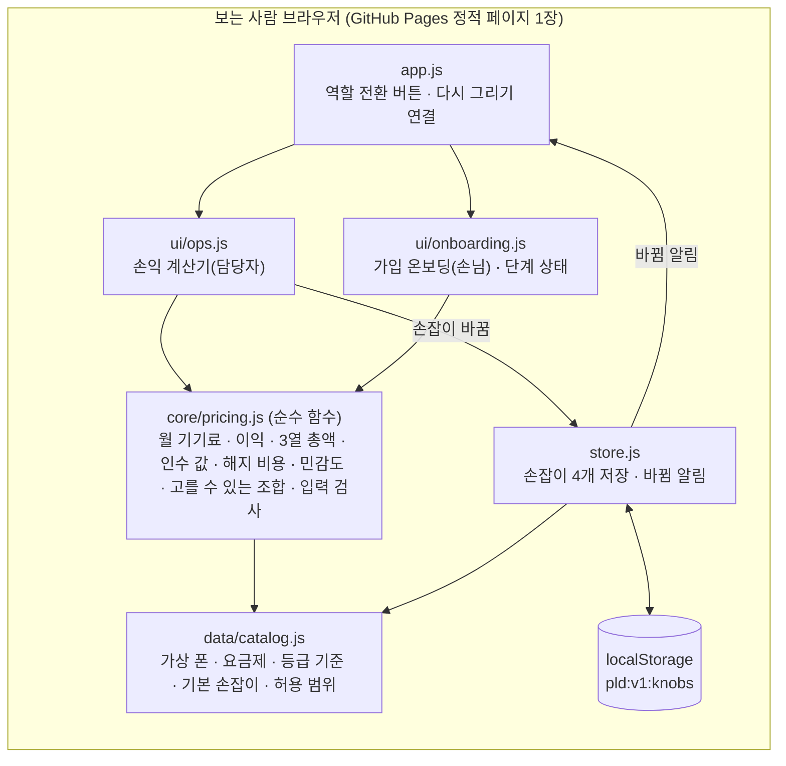
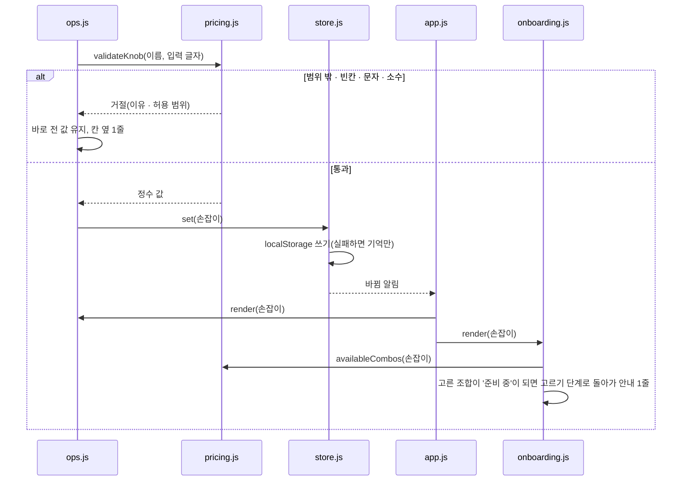

# 아키텍처

> 상태: 승인(사용자 "승인, 코드로", 2026-11-25) · 구현 반영 · 근거: [requirements.md](requirements.md)
> 데이터는 모두 가상이다. 서버 · 외부 API · 결제 · 본인 확인은 없다(ADR 0001).

## 1. 구성도



- 화면 두 개는 한 페이지 안에 함께 있다. 역할 버튼은 보이는 쪽만 바꾼다(AC-01).
- 두 화면은 같은 손잡이 값 하나를 읽는다. 그래서 가격이 어긋날 수 없다(A1 · AC-13).

## 2. 구성요소 역할

| 구성요소 | 하는 일 | 하지 않는 일 |
|---|---|---|
| `core/pricing.js` | 금액 · 이익 계산 전부. 화면이 보여 주는 모든 금액은 여기서 나온다(CLAUDE.md 규칙). 입력 검사(허용 범위 · 정수) | 화면 그리기 · 저장 |
| `data/catalog.js` | 고정 가상 데이터의 정본(AS-08~16). 바꾸지 않음 | 계산 |
| `store.js` | 손잡이 4개를 읽고 쓴다. 저장이 막히면 기본값 + `저장 안 됨` 표시(AC-21). 값이 바뀌면 등록된 함수를 부른다 | 검사 없이 저장(검사는 pricing이 먼저) |
| `ui/ops.js` | 손잡이 입력칸 4개 · 되돌리기 · 6조합 이익 표 · 고른 폰 민감도 표 · 적자 경고 | 손님 화면 상태 바꾸기 |
| `ui/onboarding.js` | 5단계 화면 · 손님 선택(폰 · 등급 · 요금제 · 지금 내는 요금 · 동의) · 완료 화면 | 손잡이 바꾸기, 내부 숫자 보이기(AC-02) |
| `app.js` | 역할 전환, 처음 그리기, store 바뀜 알림 → 두 화면 다시 그리기(AC-12) | 계산 |

## 3. 호출 흐름

### 3-1. 처음 열 때

1. `app.js`가 `store.load()`를 부른다. 저장값이 없거나 깨졌거나 읽을 수 없으면 `catalog.defaultKnobs`를 쓴다.
2. 두 화면을 손잡이 값으로 그린다. 처음 보이는 쪽은 '손님'이다.

### 3-2. 담당자가 손잡이를 바꿀 때 (AC-12 · AC-18~19)



### 3-3. 손님이 가입할 때

고르기 → 총액 비교 → 계약 규칙 미리 보기 → 동의 → 완료(AC-22). 단계 상태는 메모리에만 둔다. 새로고침하면 처음부터다. 자세한 순서는 [flows.md](flows.md).

## 4. 파일 배치

```
site/
  index.html
  css/style.css          색 토큰(AC-42) · 375px 대응(AC-44)
  js/app.js
  js/ui/html.js          글자 이스케이프
  js/store.js
  js/data/catalog.js
  js/core/pricing.js
  js/ui/ops.js
  js/ui/onboarding.js
tests/
  pricing.test.js        계산 · 사례 1 · 사례 2 · 18개 대조
  store.test.js          저장 실패 · 되돌리기
  ui.test.js             화면 글자 검사(내부 숫자 0개 · 입력칸 0개 등, 가짜 DOM 없이 그리기 함수의 HTML 문자열로)
.github/workflows/pages.yml  검사 · 올리기 작업 → 배포 작업(needs로 분리)
```

- 시험: `node --test tests/`. 화면 함수는 HTML 문자열을 돌려주는 순수 함수로 만들어 Node에서도 시험한다.
- 회사 이름 검사는 저장소 밖 지원 폴더의 스크립트로 한다(ADR 0003).

## 5. 품질 기준 연결

| 기준 | 어떻게 지키나 |
|---|---|
| 0.2초 안 다시 그리기(AC-12) | 계산은 18개 경우 × 몇 줄. 서버 없음. 화면 시험에서 시간 잼 |
| 금액 일치(AC-13) | 화면은 pricing 결과만 쓴다. 시험이 18개 경우를 다시 셈해 대조 |
| 원 단위 정수(AC-08) | 손잡이는 정수 %. 반올림은 정해진 곳에서만(data-model 3절) |
| 글자 안전 | 사용자 입력은 숫자만 받고, 화면 글자는 이스케이프해서 넣는다 |
| 외부 연결 0 | 외부 스크립트 · 글꼴 · 분석 도구 없음. CSP 메타 태그로 같은 출처만 허용 |
