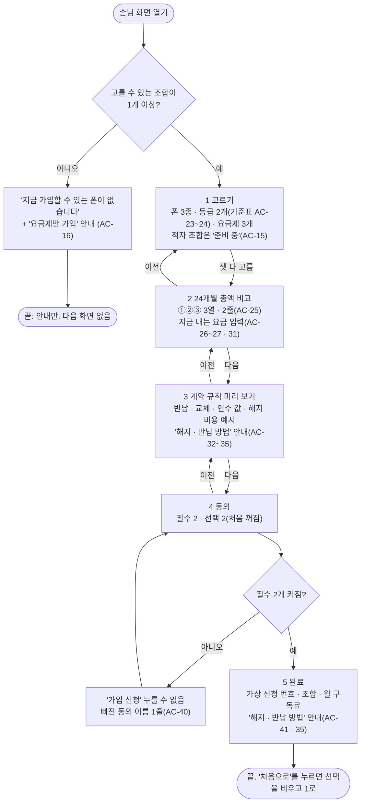
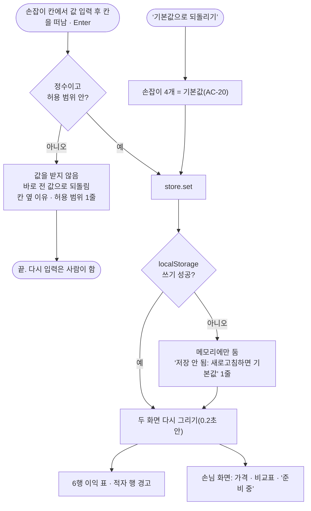
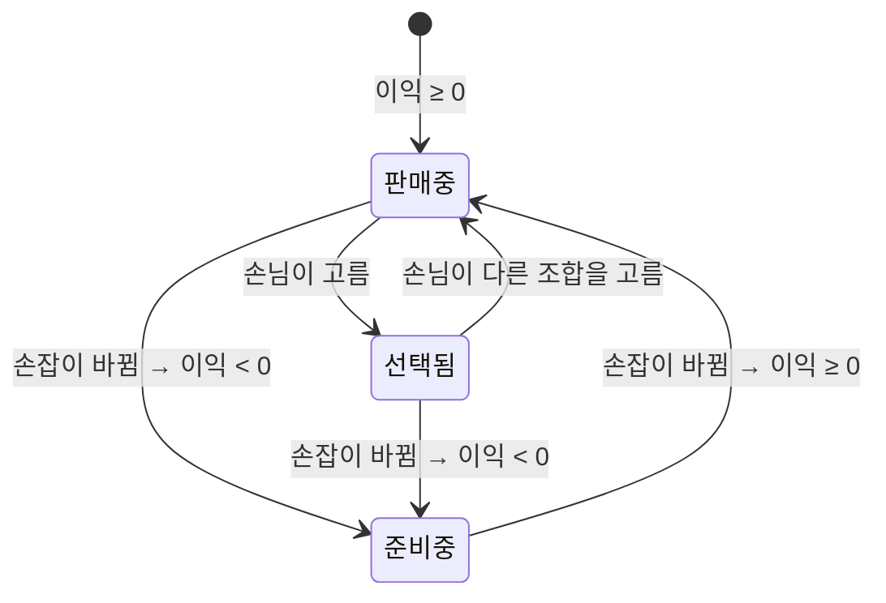

# 흐름 설계

> 상태: 승인(사용자 "승인, 코드로", 2026-11-25) · 구현 반영 · 근거: [requirements.md](requirements.md) · [data-model.md](data-model.md)

## F1. 가입 온보딩 (손님, AC-22~41)

- 단계마다 '이전' 버튼이 있다. 선택은 지우지 않는다.
- 입력칸은 지금 내는 요금 1개뿐이다. 이름 · 전화번호 · 주소 칸은 없다(AC-36).
- 끝 조건:
  - 동의 화면의 되풀이는 손님이 필수 동의를 켜거나 '이전'으로 나가면 끝난다. 자동 재시도는 없다.
  - 막다른 화면(조합 0개)은 안내 문구로 끝난다. 담당자가 손잡이를 바꾸면 다시 열린다.

## F2. 손잡이를 바꿀 때 (담당자, AC-12 · AC-14 · AC-18~21)

- 입력 검사는 칸을 떠날 때 또는 Enter에서 한 번 한다. 글자를 칠 때마다 막지 않는다.

## F3. 조합 상태 (손님 쪽에서 본 한 조합)

- 손님이 고른 조합이 '준비 중'이 되면, 손님 화면은 1 고르기 단계로 돌아간다. 그리고 "고르신 폰이 지금 준비 중입니다. 다시 골라 주세요" 1줄을 보인다. 동의는 지운다.
- 이 이동은 손잡이가 바뀔 때 한 번만 일어난다. 자동으로 되풀이되지 않는다.

## F4. 시연 순서 (포트폴리오 · 면접용)

1. **사례 1:** 손님 화면 → 중급형 · A · 보통 → 비교표 ① 858,000 · ② 860,000 · ③ 816,000원(AC-30). '남는 것' 줄로 ②가 폰이 남는다는 점도 보인다.
2. 미리 보기 → 동의(선택 동의를 끈 채) → 완료.
3. **사례 2:** 담당자로 바꿈 → 기기료율 84 · 처분율 20 → 6행 모두 적자 경고, 중급형 A −8,800원(AC-17).
4. 손님으로 바꿈 → "지금 가입할 수 있는 폰이 없습니다"와 '요금제만 가입' 안내(AC-16).
5. 담당자 → '기본값으로 되돌리기' → 손님 화면 다시 열림.

## F5. 끝 조건 점검

| 되풀이될 수 있는 곳 | 끝나는 조건 |
|---|---|
| 잘못된 입력 → 거절 | 한 번 거절하고 끝. 다시 입력은 사람이 함 |
| 동의 빠짐 → 버튼 막힘 | 손님이 켜거나 이전으로 나감 |
| 조합 0개 화면 | 안내 문구에서 끝. 다음 화면 없음 |
| 고른 조합이 준비 중 | 고르기로 1번 돌아감. 자동 반복 없음 |
| 저장 실패 | 한 번 안내하고 메모리로 계속. 재시도 없음 |
